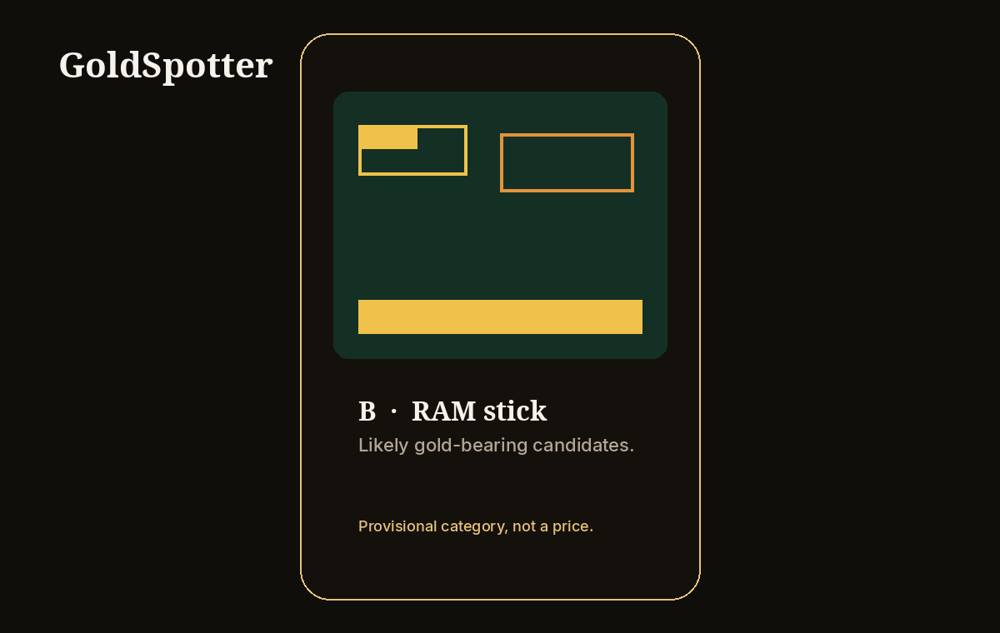

# GoldSpotter

Snap a circuit board. See which parts are likely worth the gold.

GoldSpotter is a free, mobile-first scanner for e-waste micro-scrappers. Point the camera at a board, and it marks likely precious-metal locations — fingers, pins, pads, chips, MLCCs, tantalum caps — then ranks those hotspots. It says “likely.” It does not say “gold found.”



Live demo (after you deploy the Render service): [https://goldspotter.onrender.com](https://goldspotter.onrender.com)

## Features

- Rear-camera capture and photo upload, resized in the browser before they leave the phone
- Gemini vision (optional Groq fallback) returns strict JSON: component type, tight box, likely metal, why it was flagged, and Low / Med / High confidence
- Unknown and bad-photo outcomes, with retake tips, when the picture is not enough
- Boxes colored by metal, a tappable list, and confirm / reject that stays on the device
- Scan-type switches — Gold, Silver, Palladium, Platinum, Tantalum, All components — saved in the browser, sent with the next photo, and applied to an existing result without rescanning
- Share card for X, TikTok, and Reddit, plus on-device history with clear and JSON export
- Gold reference guide. No chemical refining steps.

## How it works

1. You pick which part families to look for. At least one stays on.
2. The photo is compressed on the device and posted to `POST /api/analyze`.
3. The server asks Gemini (model from `GEMINI_MODEL`, default `gemini-3.8-flash`) for JSON only, and only for the enabled types. If Gemini fails and `GROQ_API_KEY` is set, it tries Groq once. No key returns a clear 503.
4. Boxes are clamped into the frame. “Gold found,” dollar amounts, and weights are stripped. Unsafe refining tips are dropped.
5. The result is ranked by value potential. That rank is a sorting guess, not a price.

## Local setup

Node 20 or newer.

```bash
npm install
cp .env.example .env
# add GEMINI_API_KEY
npm run dev
```

The API listens on `http://127.0.0.1:8787`. The UI is `http://127.0.0.1:5173` and proxies `/api`.

```bash
npm test
npm run build
npm start
```

`npm start` serves the built site and the API on `PORT` (8787 locally, Render’s `PORT` in production).

## Deploy to Render

One web service, defined in `render.yaml`.

- Build: `npm ci --include=dev && npm run build`
- Start: `npm start`
- Health check: `/healthz`

Set these in the Render dashboard (`sync: false` in the blueprint so the dashboard keeps them):

| Variable | Purpose |
| --- | --- |
| `GEMINI_API_KEY` | Required for live scans |
| `GEMINI_MODEL` | Optional. Default `gemini-3.8-flash`. `gemini-3.5-flash-lite` is the cheaper/faster option; `gemini-4-hydrogen` is stronger |
| `GROQ_API_KEY` | Optional backup |
| `GROQ_MODEL` | Optional. Default `qwen/qwen3.8-27b` |

The service listens on `0.0.0.0:$PORT`. Photos are not written to disk.

## Disclaimer

Estimates are approximate. The letter grade is a sorting category, not grams and not dollars. Assumptions are shown on the result. The model can miss a part or invent a box. This is an educational tool for sorting scrap you already have. Sell material to a reputable refiner, follow local e-waste laws, and do not refine with chemicals at home.

## Support

[](https://buymeacoffee.com/anthonyleebuilds)

## License

MIT. Copyright (c) 2026 Anthony Lee. See [LICENSE](LICENSE).
